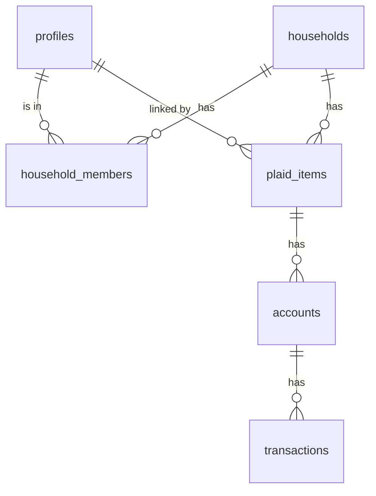

# Feature — Data Model

## Problem
Auth (#7), Plaid (#8) and bank sync (#9) all need somewhere to store people, households and bank data, with each family's data locked away from every other family.

## Goal and success metric
A schema in `migrations/` with RLS on every table, and tests proving that one household can't see another's data.

## User stories
- As a parent, I want my family's accounts in one place so that I see one total.
- As a parent, I want my kids to see only their own accounts so that our finances stay private.
- As an adult child, I want to view my parent's finances without changing them.
- As anyone, I want to belong to more than one household (my own and my parents').

## Scope
**In:** profiles, households, members and roles, Plaid items, accounts, transactions, FX rates, RLS policies, `internal/db` connection pool.
**Out:** spending limits and invitations (#12), budgets and categories (#13; since added in `0015_budgets.sql`, see [[0014-budget-totals-opt-in|ADR 0014]]), goals (#14), the bank sync write path (#8, #9), FX rate source (#11).

## Design

| Table | What it holds | Migration |
|---|---|---|
| `profiles` | One row per signed-in person. Created automatically on sign-up | `0001_households.sql` |
| `households` | A family. Has a home currency (ISO 4217) | `0001_households.sql` |
| `household_members` | Who is in which household, with one role each | `0001_households.sql` |
| `plaid_items` | One bank connection. Holds the encrypted Plaid access token | `0002_bank.sql` |
| `accounts` | Bank accounts and cards, each with its own currency | `0002_bank.sql` |
| `transactions` | Transactions, Plaid sign (positive = money out) | `0002_bank.sql` |
| `fx_rates` | Daily exchange rates for the one total | `0003_fx_rates.sql` |

**Roles**

| Role | Sees | Can change |
|---|---|---|
| owner | everything in the household | household, members, unlink any bank |
| adult | everything | unlink their own banks |
| teen | only their own accounts | unlink their own banks |
| child | only their own accounts | unlink their own banks |
| viewer | everything | nothing (except leaving) |

**Rules**
- Money is whole minor units (`bigint`, e.g. cents) next to a currency code. Never floats.
- New households are made with `create_household(name, currency)`, which makes the caller the owner.
- Every household keeps at least one owner.
- Users can read bank data but never write it. The Plaid access token column isn't readable by users at all.
- Linking and unlinking a bank go through two checked functions instead (`0004_plaid_link.sql`): only owners and adults link, only for themselves. See [[Feature - Bank Linking]].
- The bank sync writes through its own narrow role, `tallyn_sync` (`0005_bank_sync.sql`). Transaction time and location live in `transaction_details`, visible only to the person who made the transaction plus household owners for teens and children. See [[Feature - Bank Sync]].
- Credit cards (#27, `0011_credit_cards.sql`): `accounts.credit_limit_minor`, and `credit_cards` (one row per card: APRs, minimum, due date, last statement and payment, overdue), visible to whoever may see the card's balance, written only by the sync. See [[Feature - Credit Cards]].
- Loans (#27, `0013_loans.sql`): `loans` (one row per student loan or mortgage: rate, next payment and due date, payoff date, amount borrowed, past due, overdue, interest this year, plan, term), same visibility and writer as `credit_cards`; never account numbers or addresses. See [[Feature - Debts]].
- Unlinking a bank or deleting a household removes everything under it.

## Tech notes
- How the backend runs queries as the user: [[0002-backend-database-access]].
- Tests: `internal/db/db_test.go` (see [[Dev Setup]]). `TestEveryTableHasRLS` fails if a future migration forgets RLS.

## Rollout
Run the migrations in order on the Supabase project before #7 starts.

## Open questions
> [!todo] Unknown — ask Dinesh: should teens see shared household totals (without account detail)? (#12)

> [!todo] Unknown — ask Dinesh: invitations: how does someone join a household? (#12)

> [!todo] Unknown — ask Dinesh: FX rate source and refresh frequency (#11)

> [!warning] Visibility changed with #28
> Members no longer see each other's money by role. Everyone sees their own; owners and adults see their teens' and children's automatically; everything else only if the owner shared it. See [[Feature - Sharing]] and [[0007-consent-based-visibility]]. Role descriptions above that say "sees everything" are out of date.
