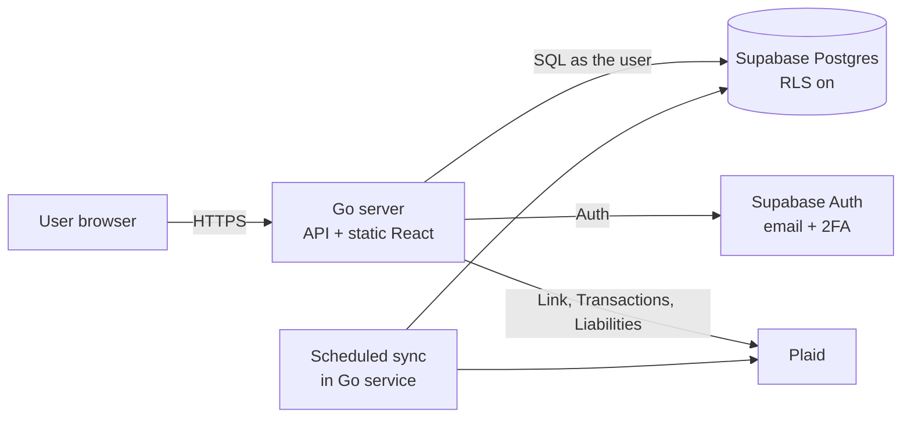

# Architecture

## Overview

One Go service, one deployment: it serves the API and the built React app (`web/dist`).

## Components
| Component | Responsibility | Path |
|---|---|---|
| Server entry | Boot, routing, static files | `cmd/server` |
| plaid | Plaid client, Link token exchange | `internal/plaid` |
| sync | Scheduled account and transaction sync | `internal/sync` |
| db | Database access | `internal/db` |
| auth | Verify Supabase sessions, enforce roles | `internal/auth` |
| api | HTTP handlers | `internal/api` |
| Web app | React UI | `web/` |
| Schema | SQL migrations | `migrations/` |

## Data model (draft)
profiles, households, household_members (with roles), plaid_items, accounts, transactions and fx_rates. Tables, roles and rules: [[Feature - Data Model]]. Budgets, categories and goals come with #13 and #14.

The backend runs each request as the signed-in user so RLS applies: [[0002-backend-database-access]].

## Security
- Plaid access tokens are **encrypted by the Go backend** before they're stored
- **RLS on every Supabase table**
- Only the backend connects to the database, and it runs user requests as the user (`internal/db` `AsUser`), not as the service role
- Secrets live in environment variables, never in the repo

## Environments
| Env | URL | Deploys from |
|---|---|---|
| Local | localhost | — |
| Prod | > [!todo] | `main` |

Decisions: `04 Tech/ADR/`.
